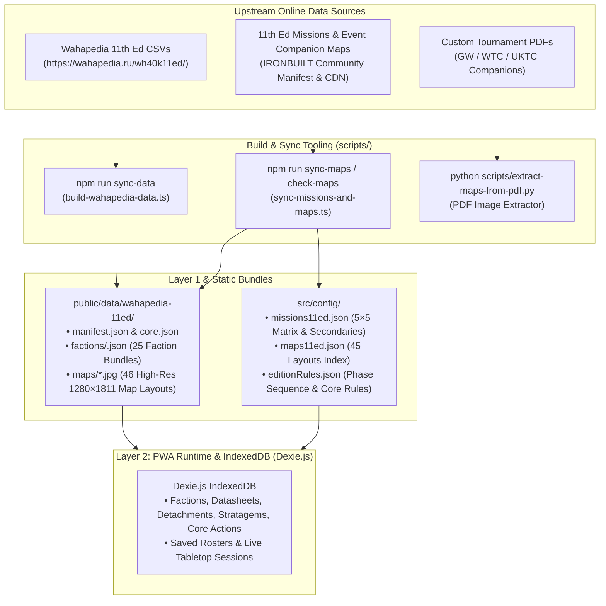

# Lex Tactica Data Pipeline & Update Workflows

This document details the automated data pipelines, update tooling, and developer/AI agent workflows for **Lex Tactica** (Warhammer 40,000 11th Edition Playbook PWA).

---

## 1. Architecture Overview

Lex Tactica follows a **2-Layer Decoupled Architecture** designed for 100% offline-capable, local-first play:



---

## 2. Tooling for Updating Datasheets, Rules & Factions

### The Wahapedia 11th Edition Pipeline
Wahapedia exports 20 relational CSV files containing all official datasheets, unit costs, wargear, detachment rules, abilities, enhancements, and stratagems.

#### Available Commands:
```bash
# 1. Inspect live Wahapedia schema & CSV headers
npm run inspect-wahapedia

# 2. Master Sync: Download latest CSVs, compile normalized JSON bundles, and sync maps
npm run sync-data
```

#### What `npm run sync-data` does:
1. Checks `https://wahapedia.ru/wh40k11ed/Last_update.csv`.
2. Downloads and caches all 20 CSV files with pipe-delimiter parsing (protecting against embedded `\n` in HTML fields).
3. Normalizes 11th Edition mechanics:
   - **Support Leaders:** Identifies 48 Support Leaders via `is_support === 'true'`.
   - **Virtual Units:** Filters out `virtual === 'true'` entries.
   - **Damaged Brackets:** Parses wound thresholds (e.g. `"1-4"`) from `damaged_w`.
   - **Detachment Points (DP):** Parses DP budgets (1–3 DP) and filters out Boarding Actions.
   - **Force Dispositions:** Extracts detachment dispositions (`Take and Hold`, `Purge the Foe`, `Disruption`, `Reconnaissance`, `Priority Assets`).
   - **Core Actions:** Splits zero-CP ability actions out into the `coreActions` store.
4. Compiles static bundles into `public/data/wahapedia-11ed/`:
   - `manifest.json` (version metadata)
   - `core.json` (core stratagems, rules, actions, keyword glossary)
   - `factions/<FACTION_ID>.json` (25 per-faction bundles)
5. Automatically triggers the mission & map sync engine to ensure game setup rules are synchronized.

---

## 3. Tooling for Updating 11th Edition Missions & Map Layouts

Lex Tactica includes a dynamic synchronization engine that tracks community-verified 11th Edition Chapter Approved Mission Decks and official Event Companion Deployment Maps.

#### Available Commands:
```bash
# 1. Check if new missions or map updates exist upstream (read-only diagnostic)
npm run check-maps

# 2. Synchronize and update all modified/new missions and map layouts
npm run sync-maps

# 3. Force re-download of all mission schemas and map images
npm run sync-maps -- --force
```

#### How Dynamic Upstream Sync Works:
1. Queries the live upstream manifest:  
   `https://raw.githubusercontent.com/IRONBUILT-LLC/ironbuilt-data/main/manifest.json`
2. Compares upstream dataset entries for `wh40k-11e-missions` and `wh40k-11e-maps` against local metadata in [`src/config/missions-meta.json`](file:///c:/agy/Lex%20Tactica/src/config/missions-meta.json).
3. If new versions or SHA-256 changes are detected:
   - Downloads updated `missions11ed.json` (5×5 directional Primary Mission Matrix with all 25 asymmetric missions, setup notes, and round scoring rules; plus 18 Secondary Mission cards).
   - Downloads updated `maps11ed.json` (45 layout mappings across pages 9–53 of the August 2026 WH40k Event Companion).
   - Smart Delta Caching: Only downloads newly added or updated map JPEGs into `public/data/wahapedia-11ed/maps/` while preserving cached files.
4. Updates `src/config/missions-meta.json`, which automatically updates the version badge displayed in the Game Setup Wizard.

---

## 4. Tooling for Custom Tournament Packs & PDF Maps

When custom map layouts are published in PDF format (such as WTC, UKTC, or local event packs):

#### PDF Map Extractor Command:
```bash
python scripts/extract-maps-from-pdf.py <path-to-pdf> [output-dir] [--pages X-Y]
```

#### Example Usage:
```bash
# Extract map diagrams from pages 7 to 10 of a tournament companion PDF
python scripts/extract-maps-from-pdf.py "C:\tournaments\WTC_2026_Maps.pdf" "public/data/wahapedia-11ed/maps/" --pages "7-10"
```
The script uses Python (`pypdf` + `Pillow`) to extract embedded graphics directly without resolution loss or manual screenshotting.

---

## 5. Standard AI Agent / Developer Workflow

When updating Lex Tactica when a new balance slate, points update, or mission pack is released, follow this 4-step sequence:

### Step 1: Check Upstream Status
```bash
npm run check-maps
```
*(Confirms whether missions or maps have been updated).*

### Step 2: Run Data Synchronization
```bash
# If Wahapedia points/rules changed OR missions changed:
npm run sync-data

# Or to update missions and maps exclusively:
npm run sync-maps
```

### Step 3: Run Automated Verification Tests
```bash
npm run test
```
*(Runs the 22 Vitest tests in `pipeline.test.ts` and `missionEngine.test.ts` verifying matrix resolution, layout matching, and detachment recommendation logic).*

### Step 4: Verify Production PWA Build
```bash
npm run build
```
*(Compiles TypeScript and creates optimized PWA production assets in `dist/`).*

---

## 6. Prompting an AI Agent for Updates

You can ask an AI agent to execute this entire process with a simple prompt:

> *"Check if there are any new Wahapedia datasheet updates or 11th edition mission/map layout updates. If there are, run the sync pipeline, execute the unit tests, and verify the production build."*

The agent will execute `npm run check-maps`, `npm run sync-data`, `npm run test`, and `npm run build` autonomously.
