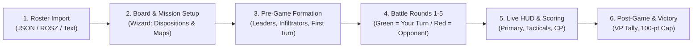

# Lex Tactica — Application Overview & Product Architecture Guide

> **Document Purpose:** This document provides a complete functional and user experience specification of **Lex Tactica** for UI/UX designers, product architects, and tabletop game accessibility experts. It details the physical tabletop environment, user personas, screen-by-screen inventory, game lifecycle state machines, and key design challenges.

---

## 1. Executive Summary & Product Mission

**Lex Tactica** is an offline-capable, local-first Progressive Web App (PWA) designed to serve as a real-time tactical companion and "cockpit" for tabletop **Warhammer 40,000 11th Edition** matches.

### The Core Problem in Modern 40k Tabletop Play
Tabletop Warhammer 40,000 is infamous for its steep learning curve and extreme cognitive load:
- Players must cross-reference core rules, faction rules, detachment rules, enhancement cards, 10–30 unit datasheets, dozens of stratagems, primary mission scoring cards, and secondary mission decks.
- In 11th Edition, players must also manage new mechanics: **Detachment Points (DP) budgets**, **5×5 Force Disposition primary matrices**, **Support Leaders** (up to 2 characters attached to a single unit), **roll-before-target charge sequences**, and **damaged wound brackets**.
- **The "Rulebook Paralysis" Failure Mode:** During physical play, players lose a significant share of their match clock flipping through PDFs, army builder apps, and rulebooks to verify whether a stratagem is legal right now or whether a unit has an active rule. (Anecdotal pain point; not measured.)
- **Lex Tactica’s Core Value Proposition:** **Contextual Progressive Disclosure.** The app reduces clutter by filtering out rules, stratagems, and abilities that are irrelevant to the current turn and phase, surfacing phase-relevant actions, active units, and phase-specific abilities first.

---

## 2. Physical Environment & Tabletop Context

Any UI/UX assessment of Lex Tactica must account for the physical conditions of miniature wargaming:
1. **Physical Spatial Constraints:** The player is standing next to a 44″ × 60″ physical tabletop filled with miniatures, terrain structures, dice trays, and tape measures. There is rarely desk space for a laptop; the device is almost always a smartphone (390px–430px width) or small tablet held in one hand or propped on the edge of the table.
2. **One-Handed Mobile Interaction:** The player's dominant hand is frequently holding dice, a tape measure, or miniatures. Taps, toggles, and status updates must have generous hit targets (minimum 44px) and require minimal precision.
3. **High Distraction & Cognitive Fatigue:** Matches last between 2.5 and 3.5 hours. By Round 4, players experience mental fatigue. UI elements must rely on clear color coding, distinct iconography, and immediate visual feedback rather than dense explanatory text.
4. **Environment Conditions (Game Stores / Tournaments):** Local game store basements and convention halls frequently have harsh overhead fluorescent lighting (requiring high-contrast dark themes) and intermittent or non-existent cellular/Wi-Fi connectivity (requiring 100% offline functionality).

---

## 3. User Personas & The Core UX Challenge

The central design tension of Lex Tactica is serving two diametrically opposed audiences without alienating either:

| Dimension | Persona A: The Beginner / Learner ("Cadet") | Persona B: The Tournament Veteran ("Warmaster") |
| :--- | :--- | :--- |
| **Experience Level** | Has played 0–5 matches. Frequently forgets phase order and core rules. | Has played 50+ matches. Knows statlines by heart; plays on a chess clock. |
| **Primary Goal** | Needs reassurance, clear "What do I do next?" guidance, and digestible rules explanations. | Needs lightning-fast score entry, secondary card tracking, and CP logging without interruption. |
| **Pain Points** | Overwhelmed by terminology (AP, OC, FNP, Devastating Wounds, Dispositions, DP). | Infuriated by modal popups, excessive tutorials, confirmations, or bloated UI wrappers. |
| **Tabletop Behavior** | Reads rule descriptions in full; hesitates during the Command and Fight phases. | Taps checkboxes in 1 second; glances at tactical secondary objectives between dice rolls. |
| **Design Need** | Progressive onboarding, contextual tooltips, and clear linear step progression. | High-density information, collapsible accordions, one-tap counters, and keyboard/quick gestures. |

---

## 4. End-to-End Game Lifecycle & User Journey

The application structures a match into six sequential states:

### Stage 1: Roster Loading & Management
- The user imports an army list from popular roster tools (New Recruit JSON, BattleScribe `.rosz`/`.ros`, or plain text) or selects a pre-seeded Space Marine Strike Force.
- The engine normalizes unit entries, wargear options, character attachments, and validates 11th Edition rules (e.g., Detachment Point budget per battle size, escalating unit copy costs).

### Stage 2: Match & Mission Setup Wizard
- A 5-step modal wizard configures the physical game:
  1. **Rosters:** Select User roster (saved or manual faction) and Opponent roster.
  2. **Force Dispositions:** Choose each player's 11th Edition Disposition (`Take and Hold`, `Purge the Foe`, `Disruption`, `Reconnaissance`, or `Priority Assets`), with automatic detachment recommendations.
  3. **Primary Mission:** Evaluates the 5×5 matrix to generate the asymmetric primary mission objectives and setup rules.
  4. **Deployment Map Selection:** Selects from 45 official 11th Edition Event Companion map layouts, indexed by the attacker/defender Force Disposition pairing (each pairing offers one or more terrain variants labelled A/B/C), with fullscreen zoom lightbox and a Terrain Key image.
  5. **Pre-Game Configuration:** Sets Battle Ready bonus (+10 VP), Tactical vs Fixed Secondaries, Attacker vs Defender, and First Turn roll-off.

### Stage 3: Pre-Game Phase
- The HUD locks into Pre-Game mode:
  - Bodyguard squads are paired with up to 1 Regular Leader + 1 Support Leader.
  - Unit battlefield locations are set: Battlefield, Strategic Reserves, or Embarked in Transports.
  - Pre-battle checklists guide deployment, Infiltrators, and Scout moves.

### Stage 4: Battle Rounds 1 to 5 (The Core Live Loop)
- The user progresses through Battle Rounds 1 to 5, stepping through the micro-phase sequence:
  - `Start of Round` $\rightarrow$ `Command` $\rightarrow$ `Movement` $\rightarrow$ `Shooting` $\rightarrow$ `Charge` $\rightarrow$ `Fight` $\rightarrow$ `End of Turn` $\rightarrow$ `End of Round`.
- **Color-Coded Cockpit:**
  - **🟢 Your Turn (Emerald):** Proactive mode. Displays phase-relevant abilities and stratagems usable in your turn.
  - **🛡️ Opponent's Turn (Crimson/Rose):** "Reactive Mode" badge. Surfaces stratagems whose timing is the opponent's turn (e.g., *Fire Overwatch*, *Heroic Intervention*). Unit cards offer a "Fire Overwatch (Show Ranged)" toggle to reveal ranged profiles during the opponent's turn.
- **Scope note:** Only the **user's own army** is tracked unit-by-unit. The opponent is represented by faction/detachment/disposition (from setup), CP, and VP — not by individual unit cards.

### Stage 5: Post-Game Resolution
- Round-by-round primary VP, secondary mission VP, and Battle Ready VP are totaled in the Scoreboard HUD and capped at 100 points.
- **Current gap:** There is no dedicated end-of-game summary/results screen; after the Round 5 End of Round step the "Next" button simply disables. Match history is not stored.

---

## 5. Screen & Component Architecture Inventory

Here is an inventory of every user interface component currently in the app:

### 1. Persistent Top Header & Slim Roster Bar (`App.tsx`)
- **Brand & Logo:** Lex Tactica crest.
- **Roster Switcher:** Displays active army name, faction, and points. Expands on click to reveal Detachment Points usage (e.g., `2/3 DP`), sub-faction, and Force Disposition.
- **Quick Action Bar:**
  - `How It Works`: Opens beginner onboarding modal.
  - `Roster & Setup`: Opens full army list editor and import tabs.
  - `New Game`: Re-launches the match setup wizard.
  - `Print`: Clean black-and-white printable playbook cheat-sheet stylesheet.
  - `Offline Sync`: 1-tap download caching all 25 faction databases for 100% offline play.

### 2. Unified Turn & Phase Cockpit (`App.tsx`)
- **Step Navigation:** Large `Prev` and `Next: [Phase]` buttons designed for quick tapping.
- **Active Phase Banner:** Displays current Battle Round (1–5), turn ownership toggle (🟢 Your Turn vs 🛡️ Opponent's Turn), and phase header.
- **Phase Strip:** 9 micro-phase pill buttons (`Pre-game`, `Start Rnd`, `Command`, `Movement`, `Shooting`, `Charge`, `Fight`, `End Turn`, `End Rnd`) allowing direct jumping to any phase if the table sequence deviates.
- **Drawer Quick Launchers:**
  - `Phase Stratagems (X)`: Badge showing how many stratagems are legally playable right now.
  - `Core Actions`: Button to pop out core movement/shooting rules.

### 3. Board & Match Setup Banner (`App.tsx` & `GameSetupWizardModal.tsx`)
- Appears prominently in Pre-Game if match parameters are not yet set.
- 5-step wizard with visual cards for choosing rosters, dispositions, asymmetric mission rules, tournament terrain layout diagrams, and secondary mission decks.

### 4. Persistent Scoreboard HUD (`ScoreboardHud.tsx`)
- **Header:** Live Total VP summary (User vs Opponent) and Command Points (CP) with `+` / `-` increment buttons.
- **Round-by-Round VP Accordion:** Collapsible breakdown of Primary VP and Secondary VP scored in Rounds 1 through 5.
- **Primary Mission Objectives:** Checklist of scoring criteria for the current battle round (e.g., "Hold 1 / Hold More / Hold Disposition Objective").
- **Secondary Mission Deck Manager:**
  - **Tactical Mode:** Simulates the Chapter Approved secondary deck (18 cards). The player draws up to 2 active cards, scores them for VP, or discards them (discard is tracked; any CP gained from discarding must be added manually via the CP counter).
  - **Fixed Mode:** Allows selecting 2 permanent secondary objectives for the match.
- **Interactive Terrain & Map Button:** Displays the active map layout chosen in setup. Tapping opens a fullscreen zoom lightbox showing the Event Companion terrain/deployment diagram.

### 5. Wahapedia Phase Action Checklist (`PhaseActionChecklist.tsx`)
- Dynamically gathers rules active *specifically* during the current phase:
  - **Army Rule Badges:** (e.g., *Oath of Moment* in Command Phase, *Waaagh!* at Start of Round).
  - **Detachment Abilities:** Rules granted by chosen detachments.
  - **Unit-Specific Abilities:** Abilities belonging to units in the player's army that trigger in this phase (e.g., Deep Strike / Rapid Ingress in Movement, Grenade ability in Shooting).
  - Interactive checkboxes allow players to mark checklist items done as they progress through the phase.

### 6. Action-First Unit Workspace (`App.tsx` & `CompositeUnitCard.tsx`)
The centerpiece of the in-game display:
- **Filter Toolbar:** Tabs filtering units by status with live counts: `🟢 Battlefield (X)`, `📦 Reserves (Y)`, `🚐 Embarked (Z)`, `💀 Destroyed (W)`, and `All`.
- **Global Actions:** `Reset Done` (unmarks all activated units), `Expand Ready Units / Collapse All`, and `Batch Status` (bulk changes unit status via dropdowns).
- **Two-Tier Layout:**
  - **Ready Units (Top):** Highlighted with emerald borders. These units still have actions available in the current phase.
  - **Completed / Inactive Units (Bottom):** Auto-collapsed into sleek 1-line rows with a checkmark once marked "Done", moving them out of the player's cognitive field.
- **Composite Unit Card Structure:**
  - **Attached Leader Banner:** If a squad has a Captain or Support Apothecary attached, they are rendered as a single cohesive unit card showing combined keywords and shared toughness.
  - **Model & Wound Counter:** Stepper buttons to increment/decrement remaining models and current model wounds.
  - **Battlefield Status Selector:** Quick toggle between Battlefield, Reserves, Embarked, and Destroyed.
  - **Phase Action Button:** Large dynamic button: e.g., `"Mark Moved"`, `"Mark Shot"`, `"Mark Charged"`, or `"Mark Fought"`. Clicking marks the unit done and moves it to the completed section.
  - **Contextual Weapon Profiles:** In Shooting, ranged profiles are shown; in Fight, melee profiles are shown. Profiles include interactive keyword tooltips (`[LETHAL HITS]`, `[DEVASTATING WOUNDS]`, `[SUSTAINED HITS X]`).
  - **Phase Stratagem Shortcuts:** Direct buttons to apply unit-eligible stratagems (e.g., *Armor of Contempt*). Locks the unit to prevent duplicate stratagem usage per phase per 11th Edition rules.

### 7. Drawers & Support Modals
- **Phase Stratagems Drawer (`PhaseStratagemsDrawer.tsx`):** Slide-over panel listing all legal stratagems for the active phase and turn, filterable by specific unit, with CP costs and detailed timing/target descriptions.
- **Core Actions Drawer (`CoreActionsDrawer.tsx`):** Instant searchable index of 11th Edition Core Actions (Normal Move, Advance, Fall Back, Shoot, Overwatch, Charge, Fight, Consolidation).
- **Interactive Keyword Tooltips (`KeywordTooltip.tsx`):** ~100ms desktop hover tooltips and mobile tap popovers explaining weapon and core abilities with dynamic variable interpolation (e.g., `FEEL NO PAIN 5+`).
- **Welcome Modal (`WelcomeModal.tsx`):** 4-step introductory guide explaining how the app simplifies match play, with direct entry buttons to import a list or use the pre-loaded starter army.

---

## 6. Key 11th Edition Tabletop Rules Implemented

Lex Tactica is built specifically for **Warhammer 40,000 11th Edition**. The following edition-specific rules influence the UI/UX. Items are marked by how far the app currently implements them.

**Enforced / surfaced in the UI today:**
1. **Detachment Points (DP) Budget:** Detachments cost 1–3 DP. Budgets come from `editionRules.json`: Incursion (1,000 pts) = 2 DP, Strike Force (2,000 pts) = 3 DP, Onslaught (3,000 pts) = 4 DP. The roster header shows usage (e.g., `2/3 DP`) and the validator flags overages.
2. **5×5 Force Disposition Mission Matrix:** Instead of symmetrical primary missions, 11th Edition pairs Player A's disposition against Player B's disposition to generate asymmetric scoring objectives. Fully resolved in the setup wizard and shown in the Scoreboard HUD.
3. **Dual Character Attachment (Regular + Support Leaders):** Bodyguard units can attach up to one Regular Leader (e.g., Captain) AND one Support Leader. The app combines these into a single composite unit card.
4. **Max 1 Stratagem Per Unit Per Phase Lock:** Once a stratagem is used on a unit, that unit is locked from further stratagems until the phase changes.
5. **Damaged Brackets:** Units with a damaged wound threshold show a "DAMAGED" profile note on their card.

**Surfaced as phase-checklist reminder text only (not enforced or interactively guided):**
6. **Charge Roll-Before-Targeting** (Charge phase: "Make 2D6 Charge Roll FIRST, then select reachable Charge Target(s)") and **Simultaneous Pile-In / Consolidate** (Fight phase sequence), sourced from `editionRules.json` → `phaseSequence`.
7. **15″ Hidden/Concealed Terrain:** Appears as a Shooting-phase checklist step ("Units obscured by terrain beyond 15″ cannot be targeted").

---

## 7. Core UI/UX Dilemmas for Evaluation

When reviewing the interface, the UX/design expert should focus on solving the following questions:

1. **Information Density vs. Cognitive Load:**
   - In the Unit Card, how can we present movement, toughness, save, invulnerable save, wounds, leadership, and objective control (M/T/Sv/Inv/W/Ld/OC) alongside 4+ weapon profiles without forcing excessive scrolling on a 390px smartphone screen?
2. **Novice Onboarding vs. Veteran Speed:**
   - Where should explanatory tooltips and "How to Play" helpers live so that a brand new player is guided step-by-step through their first Command and Movement phases, while an experienced tournament player never feels obstructed by tutorial banners?
3. **Progression Visibility:**
   - How can the app best communicate match momentum? (e.g., Which units have not yet acted, who is leading on VP, what secondaries expire at the end of the current turn).
4. **Tactical Secondary Card Handling:**
   - In 40k, drawing secondaries is a high-emotion moment. How can the card draw, completion, and discard flow feel intuitive, tactile, and rewarding?
5. **Ergonomics & Physical Reachability:**
   - The user often holds the phone with one hand while standing at the game table. **Currently, all primary controls (Prev/Next phase, phase pills, Stratagems/Core Actions launchers, CP +/-) sit at the top of the page**, and there is no sticky bottom bar. Should key controls move into thumb reach (bottom third of the screen)?
6. **Missing Lifecycle Bookends:**
   - There is no end-of-game results screen or match history, and the onboarding is a single dismissible Welcome modal (remembered via one `localStorage` flag). How should the first-run experience and the post-game experience be designed?
