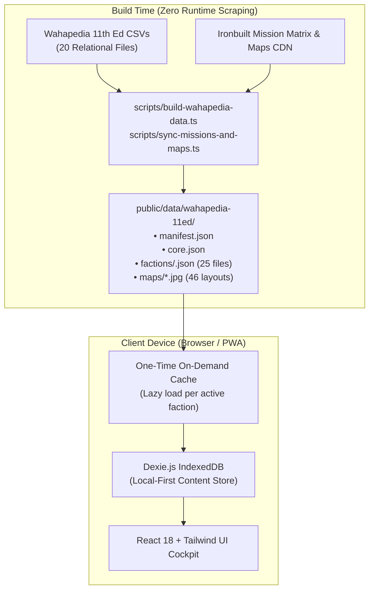

# Lex Tactica — Technical Architecture & Technology Stack Guide

> **Document Purpose:** This document details the technology stack, software architecture, data storage strategy, and technical constraints of **Lex Tactica** for technical evaluators, UI/UX engineers, and systems architects.

---

## 1. Architectural Philosophy: Local-First, Offline PWA

Lex Tactica is architected as a **Local-First, 100% Offline Progressive Web App (PWA)**. 

### Why Local-First Matters for Tabletop UX
1. **Zero Tabletop Latency:** Tabletop wargamers cannot tolerate network loading spinners while rolling dice on a chess clock. Every in-game action (marking a unit done, adjusting wounds, drawing a secondary card, opening a stratagem) is a local state update persisted to IndexedDB, with no network round-trip.
2. **Offline-Reliant Venues:** Game stores, tournament convention centers, and home basements notoriously suffer from poor cellular reception and congested or non-existent Wi-Fi. The application must function with zero network connection. (Known gap: deployment map images are not yet guaranteed offline — see §2 PWA notes.)
3. **Zero Authentication & Instant Utility:** Players do not want to create accounts, verify emails, or enter passwords before playing a game. Rosters and live match sessions persist directly in the device's client-side database (`IndexedDB`).
4. **Privacy-Preserving:** Match results, army lists, and game notes never leave the user's browser.

---

## 2. Technology Stack Breakdown

### Frontend Core
- **React (`^18.3.1`):** Functional component architecture utilizing modern React hooks (`useState`, `useEffect`, `useMemo`, `useCallback`) for deterministic state transitions.
- **TypeScript (`^5.6.3`):** Strict static typing across all game models, Wahapedia relational schemas, mission structures, and game session states.
- **Vite (`^5.4.10`):** Next-generation ESM-based build tool and dev server providing near-instant hot module replacement (HMR) and optimized tree-shaken production bundles.

### Styling & Design System
- **Tailwind CSS (`^3.4.14`):** Utility-first styling engine providing a high-contrast dark theme (`#0b0c10` background, `#14161f` surface cards, amber `#eab308` tactical accents, emerald `#10b981` active states, and crimson `#e11d48` reactive states).
- **Lucide React (`^0.454.0`):** Clean, lightweight SVG iconography tailored for tactical controls (swords, shields, crosshairs, crowns, skulls, battery levels).
- **Print Stylesheet (`no-print` classes & `@media print`):** Built-in print media optimization allowing players to export a clean, ink-friendly physical cheat-sheet directly from the browser (`Ctrl+P` / `Cmd+P`).

### Client-Side Database & Persistence
- **Dexie.js (`^4.0.8`) & `dexie-react-hooks` (`^1.1.7`):** High-performance indexed wrapper over browser `IndexedDB`.
  - **Relational Tables:** `factions`, `datasheets`, `detachments`, `enhancements`, `stratagems`, `coreActions`, `savedRosters`, `gameSessions`.
  - **Storage Durability:** Utilizes `navigator.storage.persist()` to request persistent browser storage and prevent eviction during low-disk states.
- **`localStorage`:** Used for a single UX flag: `lex_tactica_welcome_seen` (suppresses the Welcome modal). Other UI preferences (e.g., compact card mode) are currently in-memory React state and reset on reload.

### Progressive Web App (PWA) & Service Worker
- **`vite-plugin-pwa` (`^0.21.0`) & Workbox:**
  - `registerType: 'autoUpdate'`. Precaches files matching `**/*.{js,css,html,ico,png,svg,json}` (max 15 MB per file) — this **includes all faction JSON bundles**.
  - **Map JPEGs are NOT in the precache glob** and there is no runtime caching rule for them, so deployment map images require a network connection the first time they are viewed (they may then survive in the browser's HTTP cache, but this is not guaranteed offline).
  - Generates a web app manifest enabling "Add to Home Screen" installation (`display: 'standalone'`, single SVG icon).

### Army List Importers & File Parsers
- **`JSZip` (`^3.10.1`):** Decompresses and parses zipped `.rosz` files exported by BattleScribe.
- **Native JSON & XML Parsers:** Custom TypeScript importers supporting:
  - New Recruit JSON export schema.
  - BattleScribe uncompressed `.ros` XML schema.
  - Plain text roster exports (e.g., Battlescribe/GW app text summaries).

### Build Tools & Automated Testing
- **Vitest (`^2.1.3`):** 24 tests across 3 files (all passing as of 2026-10-22):
  - `missionEngine.test.ts`: 5×5 Force Disposition matrix resolution, layout matching, detachment disposition recommendations.
  - `pipeline.test.ts`: CSV parsing/normalization invariants (e.g., damaged brackets, phase normalization).
  - `defaultRoster.test.ts`: starter roster seeding and schema hydration.
  - Note: there are no UI/component tests.
- **`tsx` (`^4.19.1`):** TypeScript execution engine for build-time data ingestion scripts.

---

## 3. Data Pipeline & Zero-Scraping Runtime Model

Unlike web applications that fetch live data from remote REST/GraphQL APIs or scrape web pages at runtime, Lex Tactica uses a **2-Layer Decoupled Architecture**:

### Static Asset Bundling
- All data from Wahapedia (`https://wahapedia.ru/wh40k11ed/`) is downloaded, pipe-delimited parsed, sanitized, and normalized at build time (`npm run sync-data`).
- **Pre-Compiled JSON Assets:**
  - `public/data/wahapedia-11ed/core.json`: Core stratagems, universal actions, keyword glossaries.
  - `public/data/wahapedia-11ed/factions/<id>.json`: 25 individual faction bundles (Space Marines, Necrons, Tyranids, etc.).
- **Lazy Hydration:** When a user selects a faction, only that faction's JSON is loaded into Dexie IndexedDB. Bundle sizes vary widely: from a few KB (small factions) to ~850 KB (Aeldari) and ~1.6 MB (Space Marines).
- **Offline Sync Button:** Loads all 25 factions (~11.6 MB of JSON total) into IndexedDB in one click. Map images (~15 MB across 46 JPEGs) are separate — see the PWA caching note above.

---

## 4. Key Technical Constraints Influencing UX Design

When designing user interfaces and user flows for Lex Tactica, the following technical constraints must be observed:

1. **No Server-Side Session State:**
   - There is no central server, Redis cache, or WebSocket server. All session state (`GameSessionState`) lives inside Dexie IndexedDB on the user's physical device, keyed one session per roster.
   - There is no multiplayer sync. One device tracks the user's army unit-by-unit; the opponent is represented only by faction/disposition, CP, and VP.
2. **Mobile Screen Real Estate:**
   - Viewport target: 360px to 430px width (iPhone SE to iPhone 16 Pro Max / Samsung Galaxy).
   - Touch targets must be at least 44×44px for gloved, terrain-dusted, or dice-holding hands.
3. **Battery & CPU Efficiency:**
   - A game of 40k lasts 3+ hours with the screen frequently left on. 
   - Animations must be lightweight CSS transforms (avoid continuous heavy JavaScript canvas or 3D WebGL loops that drain device batteries during a tournament).
4. **Memory Footprint:**
   - 46 deployment map JPEGs (1280×1811, ~15 MB total) are loaded on demand in the setup wizard and lightbox modal rather than held simultaneously in DOM memory.
5. **Current Layout Reality:**
   - The layout is a single-column page capped at `max-w-5xl`. All primary navigation (Prev/Next, phase pills, drawer launchers, CP +/-) is at the **top** of the page; there is no bottom navigation bar or sticky footer controls.
